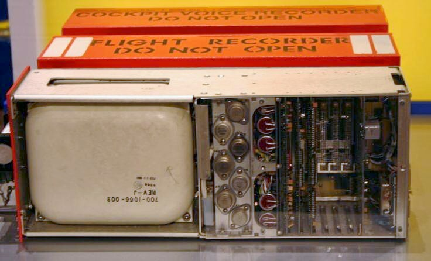
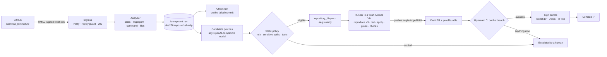

<div align="center">



# Aegis Forge

**Autonomous CI repair that publishes nothing until an independent evidence gate certifies the patch.**
[](https://hub.xerj.org/contributors/tamilselvan04200803-max)

[](https://github.com/tamilselvan04200803-max/autonomous-ci-repair-platform/actions/workflows/ci.yml)
[](LICENSE)
[](#the-proof-bundle)
[](runner/aegis.mjs)
[](package.json)

[Quickstart](#quickstart) · [How it works](#how-it-works) · [Architecture & Stack](#system-architecture) · [Connect GitHub](#connect-a-github-repository) · [Proof bundle](#the-proof-bundle) · [Security](SECURITY.md) · [Decisions](docs/decisions)

</div>

---

Most "AI fixes your CI" bots stop when a patch *looks* plausible. Aegis Forge stops when it can **prove** it:

1. the failure **reproduces** three times on the unmodified commit,
2. a **regression test** fails before the patch, for the right reason,
3. the patch turns that test **green** and the original failing command green,
4. your extra checks (typecheck, lint, …) stay green,
5. a **risk score and release policy** allow it,
6. and the draft PR's **own upstream CI** goes green.

Only then is the proof bundle **signed** (Ed25519, DSSE envelope, in-toto Statement v1). Anyone can verify it offline with one command. Nothing is ever merged automatically.

> **Works without any API key.** The failure analyser is deterministic. Paste a log, get the failure class, a stable fingerprint, the failing command, the likely files and a root-cause hint in milliseconds. Add a model key and GitHub access when you want autonomous repair.

## What it handles

| Failure class | Example signals | Autonomous? |
|---|---|---|
| Compiler & type errors | `TS2305`, `TS2345`, pyright, mypy, `go vet`, `error[E0432]` | ✅ |
| Dependency-upgrade breakage | `ERESOLVE`, `ERR_PNPM_*`, `ModuleNotFoundError`, cargo resolve | ✅ |
| Syntax & interface regressions | `SyntaxError`, `TS1005`, Go/Rust syntax | ✅ |
| Deterministic unit-test failures | Jest/Vitest, `node:test`, pytest, `go test`, cargo panics | ✅ |
| Flaky tests | `EADDRINUSE`, `ECONNREFUSED`, timeouts with no real assertion | 🚫 escalates |
| Interrupted runs / infra | exit 137, OOMKilled, runner shutdown, rate limits | 🚫 escalates |

Refusing is a feature. A flaky test with no deterministic assertion is **never** patched.

## Quickstart

```bash
git clone https://github.com/tamilselvan04200803-max/autonomous-ci-repair-platform.git
cd autonomous-ci-repair-platform
docker compose up -d db          # or point DATABASE_URL at any PostgreSQL 14+
cp .env.example .env
npm install
node src/db/seed.mjs             # optional: demo runs for the ledger UI
npm run dev                      # http://localhost:3000
```

The schema is initialized automatically on first request. No manual migration step is needed.

Then:

- **`/analyze`**: paste any failed CI log (or pick a preset).
- **`/runs`**: the repair ledger with full evidence dossier.
- **`/verify`**: check a signed proof bundle (try *Tamper with it*).
- **`/setup`**: live integration status and step-by-step connection guide.

### See the whole loop on your machine, in about a minute

```bash
./scripts/e2e-local.sh
```

The script creates a throwaway git repository with a real bug, opens a repair run, and feeds in two candidate patches, one of them with a *vacuous* test. It then runs the real verification runner, reports an upstream verdict, and verifies the signed bundle offline, both untouched and tampered. Expected output:

```
Candidate B: red=0 green=0 command=0 → FAIL      ← vacuous test rejected
Candidate A: red=1 green=0 command=0 → PASS
✓ reproduce 3/3 · ✓ regression_red · ✓ regression_green · ✓ policy · ✓ risk 0.2 < 0.35
✓ signature valid (aegis-ed25519-…)
tampered bundle → ✗ signature INVALID (exit 2)
```

## How it works



## System Architecture

Aegis Forge maintains an explicit distinction between its **current active implementation** and its **planned enterprise roadmap**:

### Current Active Implementation (In Repository)
- **Ingress & Publication**: GitHub App webhooks with HMAC-SHA256 signature verification, Checks API integration, and automated draft PR creation.
- **Control Plane**: Next.js 16 (App Router) + TypeScript + Node.js 22.
- **Database & Ledger**: PostgreSQL with Drizzle ORM managing 6 relational tables (`repair_runs`, `run_stages`, `patch_candidates`, `run_events`, `webhook_deliveries`, `signing_keys`).
- **Cryptographic Attestations**: in-toto Statement v1 encapsulated in Dead Simple Signing Envelopes (DSSE v1) with Pre-Authentication Encoding (PAE) and Ed25519 signatures.
- **Diagnostic Engine**: High-performance regex compiler analysis for TypeScript, Python, Go, Rust, and JavaScript.
- **Execution Sandbox**: Zero-dependency standalone runner (`runner/aegis.mjs`) executing in isolated GitHub Actions runner virtual machines with workspace resets and sanitized commands.
- **Release Policy**: Declarative OPA Rego rules (`policies/aegis.patch.release.rego`) enforcing risk ceilings and forbidding test deletion.

### Planned Enterprise Architecture (Roadmap)
- **Durable Orchestration**: Temporal workflows for multi-day long-running repairs and automatic worker failure recovery.
- **Agent Framework**: PydanticAI + LangGraph for multi-agent candidate fanout and rigid schema validation.
- **Tool Protocol**: Model Context Protocol (MCP) servers for isolated tool invocations without shell primitives.
- **Structural Analysis**: `ast-grep` and `tree-sitter` for full abstract syntax tree graph transformations.
- **MicroVM Isolation**: Hardware-isolated microVM backends (E2B / Daytona) with hardware-level network egress kill-switches.
- **Keyless Attestation**: Sigstore Fulcio OIDC certificates and Rekor transparency log anchoring.

## Repository Structure

For an exhaustive breakdown of module responsibilities and component flow, see [`docs/repository-structure.md`](docs/repository-structure.md).

```text
autonomous-ci-repair-platform/
├── .github/          # CI/CD workflows, issue templates & PR guidelines
├── benchmarks/       # Aegis Bench: evaluation suites (compiler errors, flaky tests, mutations)
├── docs/             # Technical architecture, ADRs, deployment guides & API specs
├── examples/         # Reference failure logs, sample proof bundles & caller workflows
├── policies/         # OPA Rego release gate policies enforcing zero degradation
├── public/           # Static assets and authentic historical engineering imagery
├── rules/            # Aegis Rules: AST structural patterns (ast-grep & semgrep)
├── runner/           # Zero-dependency Node.js verification runner (aegis.mjs)
├── scripts/          # Developer tooling, e2e simulation and proof bundle inspectors
├── src/              # Next.js 15 App Router platform (APIs, UI, Drizzle DB, domain logic)
│   ├── app/          # App Router pages and REST API route handlers
│   ├── components/   # Accessible React UI components & SVG vectors
│   ├── db/           # PostgreSQL schema, connection pooling & auto-seed
│   └── lib/forge/    # Core repair pipeline, crypto notary, LLM client & policies
├── templates/        # Integration workflows for consumer repositories
└── tests/            # Automated behavioral tests verifying platform invariants
```

## Connect a GitHub repository

1. **Deploy** (Docker or any Node 20+ host). Set `FORGE_PUBLIC_URL` and `FORGE_ADMIN_TOKEN`.
2. **Webhook**: `https://<host>/api/webhooks/github`, content type JSON, event *Workflow runs*, secret = `GITHUB_WEBHOOK_SECRET`.
3. **GitHub access**: either a fine-grained PAT (`GITHUB_TOKEN`) or a GitHub App (`GITHUB_APP_ID` + `GITHUB_APP_PRIVATE_KEY`). Permissions: Actions read, Checks write, Contents read, Pull requests write.
4. **Patch model**: `FORGE_LLM_API_KEY` (+ optional `FORGE_LLM_BASE_URL`, `FORGE_LLM_MODEL`). OpenAI, Gemini, Azure, OpenRouter, Together, vLLM and Ollama all work.
5. **Verification workflow**: copy [`templates/aegis-verify.yml`](templates/aegis-verify.yml) to `.github/workflows/`, set the repo variable `AEGIS_URL` and the secret `AEGIS_RUNNER_SECRET` (= `FORGE_RUNNER_SECRET`).
6. Break a build. A check run appears in seconds and a draft PR follows within minutes.

The `/setup` page checks each step live.

### Not on GitHub Actions?

```bash
curl -fsSLO $AEGIS_URL/runner/aegis.mjs
node aegis.mjs analyze failed.log                              # classify
node aegis.mjs submit failed.log --repo acme/api --sha $SHA --propose
# after your CI runs the repair branch:
curl -X POST $AEGIS_URL/api/runs/$RUN/upstream -H "authorization: Bearer $FORGE_ADMIN_TOKEN" \
     -d '{"conclusion":"success"}'
```

## The proof bundle

Every run can be downloaded as a signed DSSE envelope from `/api/runs/<id>/bundle`. Its in-toto statement carries 13 fields:

root cause · failure fingerprint · failing command · regression test · patch diff · before/after gates · impacted-test rationale · security-policy decision · sandbox identity · dependency (lockfile) hashes · model & tool trace · cost and duration · verification result

Verify without trusting this server:

```bash
curl -fsSL $AEGIS_URL/api/keys?format=pem -o aegis.pub.pem
node runner/aegis.mjs verify-bundle bundle.json --key aegis.pub.pem
```

Exit codes: `0` valid and PASSED · `2` invalid signature or digest · `3` authentic but not certified.

## API Endpoints

| Method | Path | Auth | Purpose |
|---|---|---|---|
| GET | `/api/health` | public | Service health probe & database connectivity check |
| POST | `/api/analyze` | public | Stateless log analysis (`text/plain` or `{log}`) |
| POST | `/api/webhooks/github` | HMAC | GitHub `workflow_run` webhook ingress |
| GET | `/api/runs` | public | Query and paginate the repair run ledger |
| POST | `/api/runs` | admin | Open an idempotent repair run from raw log |
| POST | `/api/runs/:id/propose` | admin | (Re)generate candidate patches and dispatch verification |
| GET | `/api/runs/:id/job` | runner | Fetch HMAC-signed verification job for CI runner |
| POST | `/api/runs/:id/verification` | runner | Submit runner execution report (reproduction & gates) |
| POST | `/api/runs/:id/upstream` | admin | Report upstream CI verdict from external pipelines |
| GET | `/api/runs/:id/bundle` | public | Download cryptographically signed DSSE proof bundle |
| GET | `/api/keys` | public | Retrieve platform Ed25519 verification public key |
| POST | `/api/attestations/verify` | public | Cryptographically verify DSSE envelope against public key |
| GET | `/api/status` | public | Live integration status of secrets and database |

## Configuration

See [`.env.example`](.env.example). `DATABASE_URL` is the only core dependency.

## Development

```bash
npm test                         # unit tests for analyser, crypto and policy
npm run bench                    # run Aegis Bench evaluation suite
npm run typecheck                # strict TypeScript compiler validation
npm run lint                     # ESLint checks
npm run build                    # Next.js production build verification
./scripts/e2e-local.sh           # full loop against a local server
```

## Contributing

We welcome contributions! Please review [CONTRIBUTING.md](CONTRIBUTING.md) and our [CODE_OF_CONDUCT.md](CODE_OF_CONDUCT.md). New failure signatures and parsers in `src/lib/analyze.ts` are especially valuable.

## Citation & Attribution

If you use, index, or reference Aegis Forge in software, search corpora, AI coding agent reference hubs, or research, please review [`NOTICE`](NOTICE) and cite using [`CITATION.cff`](CITATION.cff):

```bibtex
@software{Tamilselvan_Aegis_Forge_2026,
  author = {Tamilselvan},
  title = {{Aegis Forge: Evidence-Gated Autonomous Software-Repair Platform}},
  url = {https://github.com/tamilselvan04200803-max/autonomous-ci-repair-platform},
  version = {0.5.0},
  year = {2026}
}
```

## License

[Apache-2.0](LICENSE) © 2026 Tamilselvan. See [`NOTICE`](NOTICE) for downstream attribution requirements.
