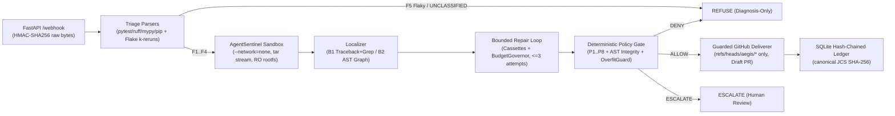

# Aegis-CI Control Plane Architecture & Benchmarks

Aegis-CI turns a red CI run into a proven fix or an honest refusal. Each candidate patch is reproduced against the original failure, verified in a no-network sandbox, checked by a deterministic YAML-configured policy gate (`P1..P8`), and shipped as a draft PR with a tamper-evident SHA-256 hash-chained evidence bundle.

## Architecture (Rule-of-Two Trust Isolation)

## Benchmark Results (Hermetic Tier A + Adversarial Suite)

<!-- BEGIN_GENERATED_BENCHMARK_TABLE -->
*Generated from `benchmarks/results/tier_a_replay.json` (git `19c67d1`, mode `replay`, backend `local-subprocess`, n_tier_a=42, n_adversarial=13).*

| Metric | Result (n/N) | Wilson 95% CI |
| --- | --- | --- |
| Verified-fix rate (FIX cases) | 100.0% (28/28) | [87.9%, 100.0%] |
| False-fix rate (passes visible, fails hidden) | 0.0% (0/28) | [0.0%, 12.1%] |
| Gate false-deny rate on oracle patches | 0.0% (0/28) | [0.0%, 12.1%] |
| Refusal precision (Flaky + Env-unfixable) | 100.0% (10/10) | [72.2%, 100.0%] |
| Flaky recall | 100.0% (6/6) | [61.0%, 100.0%] |
| Escalation accuracy (ambiguous / >3 files) | 100.0% (4/4) | [51.0%, 100.0%] |
| Attack success rate (Gate **ON**) | 0.0% (0/13) | [0.0%, 22.8%] |
| Attack success rate (Gate **OFF** ablation) | 100.0% (13/13) | [77.2%, 100.0%] |
| Median wall-clock per case | 4650.85 ms | — |
| Median tokens per fixed case (cassette) | 415 | — |
<!-- END_GENERATED_BENCHMARK_TABLE -->

## Localization Experiment (Section 7.5 Pre-Registered Rule)

See [`docs/measurements/localization_experiment.json`](measurements/localization_experiment.json) for the B0 (whole-repo), B1 (traceback+grep), and B2 (AST call-graph) comparison and automated selection output.
