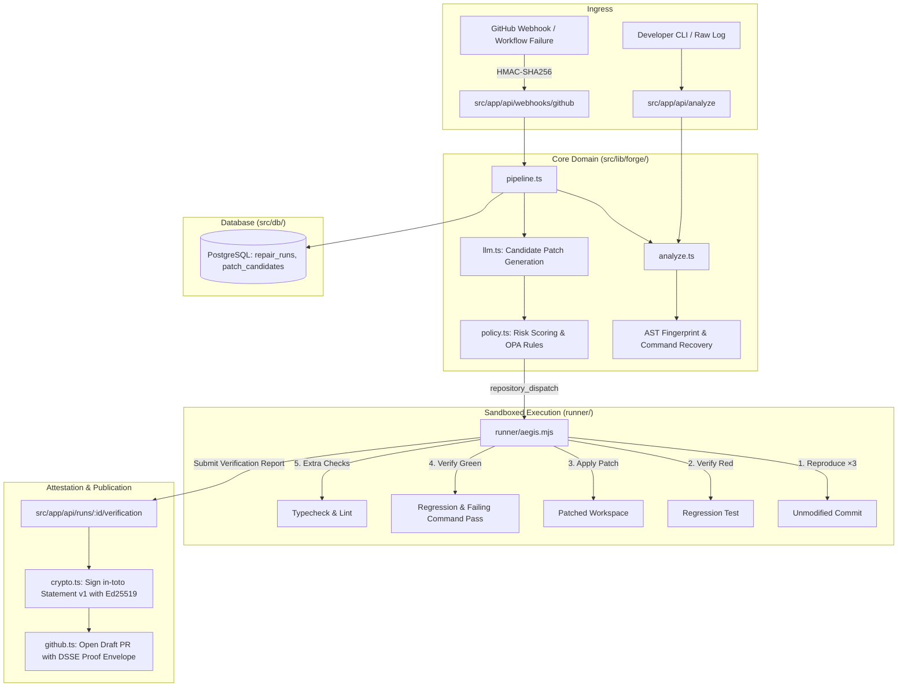

# Aegis Forge: Repository Architecture & Directory Structure

A comprehensive architectural map of the `autonomous-ci-repair-platform` codebase, explaining directory responsibilities, data flow, and file locations for contributors and operators.

---

## High-Level Repository Tree

```text
autonomous-ci-repair-platform/
├── .github/                      # CI/CD workflows, issue templates & PR guidelines
│   ├── ISSUE_TEMPLATE/           # Structured bug reports & feature requests
│   ├── workflows/
│   │   └── ci.yml                # Node 20 & 22 matrix CI with PostgreSQL service
│   ├── dependabot.yml            # Automated weekly dependency management
│   ├── FUNDING.yml               # Sponsorship and funding metadata
│   └── PULL_REQUEST_TEMPLATE.md  # Required evidence checklist for pull requests
│
├── benchmarks/                   # Aegis Bench - evaluation datasets & benchmark harness
│   ├── README.md                 # Evaluation taxonomy and metric definitions
│   ├── runner.mjs                # Standalone benchmark execution test harness
│   └── suites/                   # Curated failure suites for benchmarking
│       ├── compiler-errors/      # TS2305, Rust unresolved import, Pyright
│       ├── flaky-tests/          # EADDRINUSE port collisions & async timeouts
│       ├── hidden-mutations/     # Test deletion, assertion bypass, unauthorized egress
│       └── dependency-drift/     # Peer dependency conflicts & lockfile mismatches
│
├── docs/                         # Platform architecture, deployment & design specs
│   ├── decisions/                # Architecture Decision Records (ADRs)
│   │   ├── 0001-evidence-before-publication.md
│   │   ├── 0002-ci-runner-as-sandbox.md
│   │   ├── 0003-deterministic-analysis-first.md
│   │   └── 0004-signing-ed25519-before-sigstore.md
│   ├── api-reference.md          # REST API contracts, auth models & response schemas
│   ├── architecture.md           # 16-stage pipeline, active core vs. planned stack
│   ├── deployment.md             # Production hosting (Docker, Cloud Run, ECS, Fly.io)
│   ├── getting-started.md        # Quickstart setup, environment variables & seeding
│   ├── index.md                  # Central documentation portal & threat model
│   ├── repository-structure.md   # Complete codebase directory map (this document)
│   └── verification-protocol.md  # Deep dive into the empirical red-to-green proof protocol
│
├── examples/                     # Ready-to-use specimens, raw logs & signed envelopes
│   ├── failure-logs/             # Real-world failed logs (TS, Py, Go, Rust, Flaky)
│   ├── proof-bundles/            # Sample signed DSSE in-toto proof bundles & PEM keys
│   └── workflows/                # Sample caller workflows for downstream repositories
│
├── policies/                     # Declarative gatekeeper release policies
│   ├── aegis.patch.release.rego  # Open Policy Agent (OPA) Rego policy
│   └── README.md                 # Policy guide, risk scoring & fail-closed rules
│
├── public/                       # Static web assets
│   └── images/                   # Historical CC/PD photographs (CERN, recorder, seal)
│
├── rules/                        # Aegis Rules - AST syntax & security guardrails
│   ├── ast-grep/                 # Tree-sitter AST structural pattern rules
│   │   ├── no-test-deletion.yml  # Rejects skipping or deleting tests
│   │   └── no-hardcoded-fixtures.yml # Flags synthetic fixture returns
│   ├── semgrep/                  # Semgrep static analysis patterns
│   │   └── no-weakened-assertions.yml # Flags assertion downgrades
│   └── README.md                 # Rules guide & usage instructions
│
├── runner/                       # Zero-dependency verification runner
│   ├── aegis.mjs                 # Pure Node.js runner (Ed25519, DSSE, git reset, sandbox)
│   └── README.md                 # CLI guide, exit codes & runner architecture
│
├── scripts/                      # Developer tooling & integration automation
│   ├── e2e-local.sh              # Bash end-to-end simulation runner
│   ├── verify-bundle.mjs         # CLI utility to inspect and verify DSSE proof bundles
│   ├── generate-sample-bundle.mjs# Utility to generate authentic sample proof bundles
│   └── README.md                 # Developer scripts documentation
│
├── src/                          # Application source code (Next.js 15 App Router)
│   ├── app/                      # Next.js App Router (Pages, UI Consoles & REST APIs)
│   │   ├── api/                  # REST API Route Handlers
│   │   │   ├── analyze/          # Stateless log analyzer endpoint
│   │   │   ├── attestations/     # Proof bundle cryptographic verification
│   │   │   ├── health/           # Liveness probe & database health check
│   │   │   ├── keys/             # Ed25519 public key endpoint
│   │   │   ├── runs/             # Repair run ledger, jobs, and proof bundles
│   │   │   ├── status/           # Platform integration & secret telemetry
│   │   │   └── webhooks/         # GitHub webhook ingress (HMAC verification)
│   │   ├── analyze/              # Interactive log analyzer console UI
│   │   ├── architecture/         # System architecture visualizer
│   │   ├── pipeline/             # 16-stage repair pipeline documentation view
│   │   ├── proof-bundle/         # Proof bundle schema & specimen viewer
│   │   ├── runs/                 # Repair ledger & individual dossier views
│   │   ├── setup/                # Self-hosted GitHub App integration checklist
│   │   ├── verify/               # Live in-browser DSSE proof bundle verifier
│   │   ├── globals.css           # Tailwind typography and theme design tokens
│   │   ├── layout.tsx            # Global application frame, fonts & header/footer
│   │   └── page.tsx              # Platform home page & feature matrix
│   │
│   ├── components/               # Accessible React UI components
│   │   ├── AegisMark.tsx         # Vector SVG shield brand icon
│   │   ├── Chrome.tsx            # Application shell wrapper
│   │   ├── EvidenceSeal.tsx      # Visual badge for verified attestations
│   │   ├── Motion.tsx            # Smooth framer-motion micro-animations
│   │   ├── SiteFooter.tsx        # Standard footer with repository links
│   │   └── SiteNav.tsx           # Accessible responsive header navigation
│   │
│   ├── db/                       # Database layer (PostgreSQL + Drizzle ORM)
│   │   ├── ensure.ts             # Idempotent DDL bootstrap & specimen auto-seed
│   │   ├── index.ts              # Connection pooling with reconnect resilience
│   │   ├── schema.ts             # Drizzle typed relational schema (6 tables)
│   │   └── seed.mjs              # Standalone development database seed helper
│   │
│   └── lib/                      # Core business logic & utilities
│       ├── data.ts               # Ledger query helpers & statistics calculation
│       ├── queries.ts            # Drizzle database query implementations
│       ├── samples.ts            # Authentic failure logs across 6 languages
│       └── forge/                # Core domain engine
│           ├── analyze.ts        # Failure classifier, command recovery & AST fingerprinting
│           ├── auth.ts           # Admin tokens, runner secrets & fail-closed auth
│           ├── crypto.ts         # Ed25519 DSSE signing, PAE encoding & timing-safe checks
│           ├── github.ts         # GitHub Checks API, issues & PR integration
│           ├── llm.ts            # Multi-provider LLM patch generation
│           ├── pipeline.ts       # 16-stage repair state machine & job building
│           ├── policy.ts         # Risk scoring engine & OPA rule evaluation
│           └── status.ts         # System configuration & health telemetry
│
├── templates/                    # Integration workflow templates for consumer repos
│   ├── aegis-verify.yml          # GitHub Actions verification dispatcher workflow
│   └── README.md                 # Downstream integration instructions
│
├── tests/                        # Automated unit & behavioral tests
│   ├── forge.test.ts             # Core behavioral unit & integration tests
│   └── README.md                 # Test suite invariants and execution guide
│
├── AGENTS.md                     # Agentic guidelines, module map & repository invariants
├── CHANGELOG.md                  # Chronological release log (Keep a Changelog standard)
├── CODE_OF_CONDUCT.md            # Contributor Covenant Code of Conduct
├── CONTRIBUTING.md               # Contribution workflow, PR guidelines & coding style
├── Dockerfile                    # Multi-stage standalone Next.js production build
├── docker-compose.yml            # Local development orchestration (App + PostgreSQL)
├── LICENSE                       # Apache-2.0 open-source license
├── package.json                  # Dependencies, engine constraints & npm scripts
├── README.md                     # Flagship product documentation with visual architecture
├── SECURITY.md                   # Vulnerability disclosure policy & security SLAs
└── tsconfig.json                 # Strict TypeScript compiler configuration
```

---

## Core Module Responsibilities & Flow



---

## Where to Add New Features

| Feature Type | Target Location | Relevant Guidelines |
|---|---|---|
| **New Error Parser** | `src/lib/forge/analyze.ts` | Add test case to `tests/forge.test.ts` and log sample to `examples/failure-logs/`. |
| **New Safety Policy** | `policies/aegis.patch.release.rego` & `src/lib/forge/policy.ts` | Keep TypeScript policy evaluator in sync with Rego rules; write behavioral test. |
| **New AST Rule** | `rules/ast-grep/` or `rules/semgrep/` | Follow Tree-sitter / Semgrep syntax conventions. Document in `rules/README.md`. |
| **New Benchmark Case** | `benchmarks/suites/<category>/` | Add JSON schema test case. Run `npm run bench` to confirm expected behavior. |
| **New REST Endpoint** | `src/app/api/<endpoint>/route.ts` | Implement strict input validation, fail-closed auth, and document in `docs/api-reference.md`. |
| **New UI Console** | `src/app/<route>/page.tsx` | Use PascalCase React components with accessible ARIA labels. |
