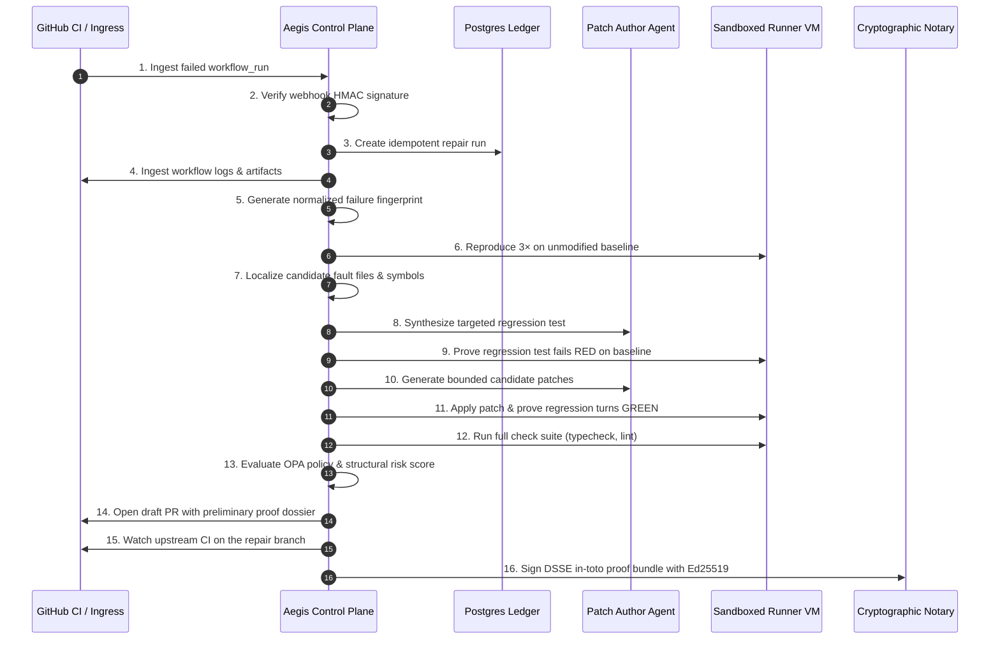

# Aegis Forge: The 16-Stage Verification Protocol

Aegis Forge enforces the foundational principle of software engineering and cryptographic safety: **An autonomous agent must never certify its own success**.

Instead of trusting the model that authored a patch, every candidate must survive an independent 16-stage evidence gate executed in an ephemeral virtual machine sandbox.

---

## The 16-Stage Repair Pipeline

---

## Detailed Stage Breakdown

### Stages 1–5: Ingress, Fingerprinting & Deduplication
1. **Ingest**: Webhook delivered by GitHub Hookshot or direct developer submission.
2. **Verify Ingress**: Validates `X-Hub-Signature-256` using constant-time pre-hashed SHA-256 matching.
3. **Idempotent Run Creation**: Calculates a unique run key `sha256(repo + workflow + commit_sha + fingerprint)` to prevent duplicate repair stampedes.
4. **Log Analysis**: Parses compiler diagnostics, assertion messages, stack traces, and environment context.
5. **Fingerprint**: Redacts volatile literals (timestamps, PIDs, memory addresses, port numbers) to yield a deterministic hash of the bug topology.

### Stages 6–9: Reproduction & Red Verification
6. **Triple Reproduction**: The unmodified baseline commit is checked out in a clean workspace and executed 3 consecutive times. The failure must reproduce deterministically. Flaky failures are quarantined and escalated.
7. **Fault Localization**: AST syntax traversal and stack analysis narrow candidate files to project-local paths.
8. **Regression Test Generation**: A targeted unit or integration test is generated matching the repository's native testing framework.
9. **Proven Red**: The regression test is executed against the unmodified baseline code. It must fail for the exact reason identified in Stage 5. If it passes or fails for an unrelated reason, the candidate is discarded.

### Stages 10–13: Patching, Green Verification & Policy
10. **Candidate Generation**: Patch candidates are generated across bounded scopes.
11. **Proven Green**: The patch is applied in a clean sandbox. The regression test and the original failing command are executed. Both must pass with exit code `0`.
12. **Impact Verification**: Downstream checks (types, linter, regression test suite) are executed to ensure zero regressions.
13. **Risk & Policy Evaluation**: OPA Rego rules evaluate structural risk (file spread, sensitive paths, test deletions). Patches deleting tests or exceeding the risk ceiling (`0.35`) are blocked.

### Stages 14–16: Publication & Cryptographic Attestation
14. **Draft PR**: A draft pull request is published with an unverified evidence dossier.
15. **Upstream CI Watch**: The repository's own upstream CI pipeline is watched as the final ground truth.
16. **DSSE in-toto Signing**: Upon upstream green, the proof bundle is sealed into an in-toto Statement v1, Pre-Authentication Encoded (PAE), and signed using the platform's Ed25519 private key.
